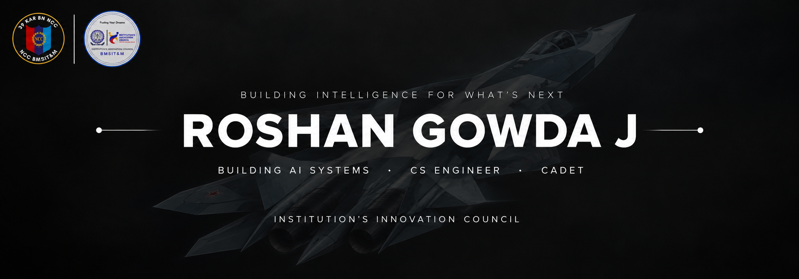

 <!-- ================= HERO BANNER ================= -->

  

  <i>BUILDING WHAT DOESN'T EXIST YET</i>

  <b>BUILDING AI SYSTEMS · CS ENGINEERING · CADET</b>

  I turn ambitious ideas into intelligent products that solve real-world problems.

  <a href="https://www.linkedin.com/in/roshan-gowda/">LinkedIn</a> ·
  <a href="https://www.instagram.com/roshan.gowda1/">Instagram</a> ·
  <a href="https://roshan-gowda.vercel.app/">Website</a> ·
  <a href="https://leetcode.com/u/mig_Roshan/">LeetCode</a>

---

## About

I'm **Roshan Gowda J** — a computer science engineer, AI builder, and cadet passionate about turning ambitious ideas into useful technology.

I enjoy exploring AI agents, developing software, and building products that solve real-world problems.

---

## Toolbox

<h3 align="center">AI Agents & Ecosystem</h3>

  
  
  
  

<h3 align="center">Languages</h3>

  
  
  
  
  
  
  

<h3 align="center">Frameworks & Development</h3>

  
  
  
  
  

<h3 align="center">Cloud, Databases & Infrastructure</h3>

  
  
  
  
  
  
  
  

<h3 align="center">Security & Testing</h3>

  
  
  

---

<h2 align="center">Projects & Applications</h2>

<table>
  <thead>
    <tr>
      <th>Project</th>
      <th>Overview</th>
      <th>Technologies</th>
    </tr>
  </thead>
  <tbody>
    <tr>
      <td>
        <a href="https://github.com/imroshan737-gif/BreachGuard"><b>BreachGuard</b></a>
      </td>
      <td>Detects website vulnerabilities and helps prevent security breaches.</td>
      <td>
        
        
        
        
        
        
        
      </td>
    </tr>
    <tr>
      <td>
        <a href="https://github.com/imroshan737-gif/gluco-guardian"><b>GlucoGuardian</b></a>
      </td>
      <td>Non-invasive glucose monitoring proof of concept using optical sensing and machine learning.</td>
      <td>
        
        
        
        
      </td>
    </tr>
    <tr>
      <td>
        <a href="https://github.com/imroshan737-gif/MicroMuse"><b>MicroMuse</b></a>
      </td>
      <td>A web-based creative habit-building and productivity platform.</td>
      <td>
        
        
        
        
        
      </td>
    </tr>
    <tr>
      <td>
        <a href="https://github.com/imroshan737-gif/SenseU"><b>SenseU</b></a>
      </td>
      <td>An AI-driven mental wellness platform that helps users monitor, analyze, and reduce stress.</td>
      <td>
        
        
        
        
        
      </td>
    </tr>
  </tbody>
</table>

---

## GitHub

  <a href="https://github.com/imroshan737-gif?tab=repositories">Explore My Repositories</a> ·
  <a href="https://github.com/imroshan737-gif">View My GitHub Activity</a>

---

  <b>THE FUTURE ISN'T SOMETHING WE WAIT FOR.</b>
    
  <b>IT'S SOMETHING WE BUILD.</b>

