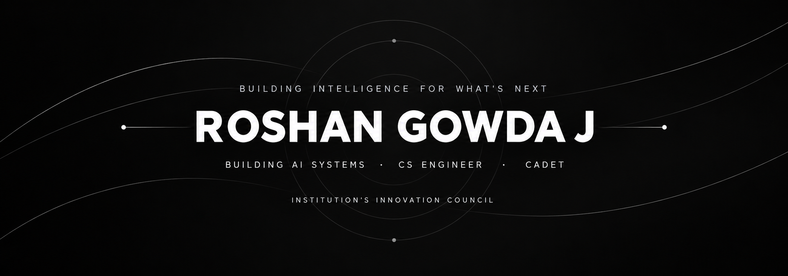

 

  

  <i>AGENTIC AI · CS ENGINEER · SOLVING PROBLEMS</i>

  I turn ambitious ideas into intelligent products that solve real-world problems.

  <a href="https://www.linkedin.com/in/roshan-gowda/">LinkedIn</a> ·
  <a href="https://www.instagram.com/roshan.gowda1?igsh=MXd1ZzhzcTdodDl0Yw==">Instagram</a> ·
  <a href="https://roshan-gowda.vercel.app/">Website</a>

---

## About

I'm **Roshan Gowda J** — a computer science engineer, AI builder, and an individual passionate about turning ambitious ideas into useful technology.

I enjoy exploring AI agents, developing software, and building products that solve real-world problems.

---

## Toolbox

<h3 align="center">AI Agents</h3>

  
  
  

<h3 align="center">Tech Stack</h3>

  

---

  <strong>THE FUTURE ISN'T SOMETHING WE WAIT FOR.</strong>
   
  <strong>IT'S SOMETHING WE BUILD.</strong>

